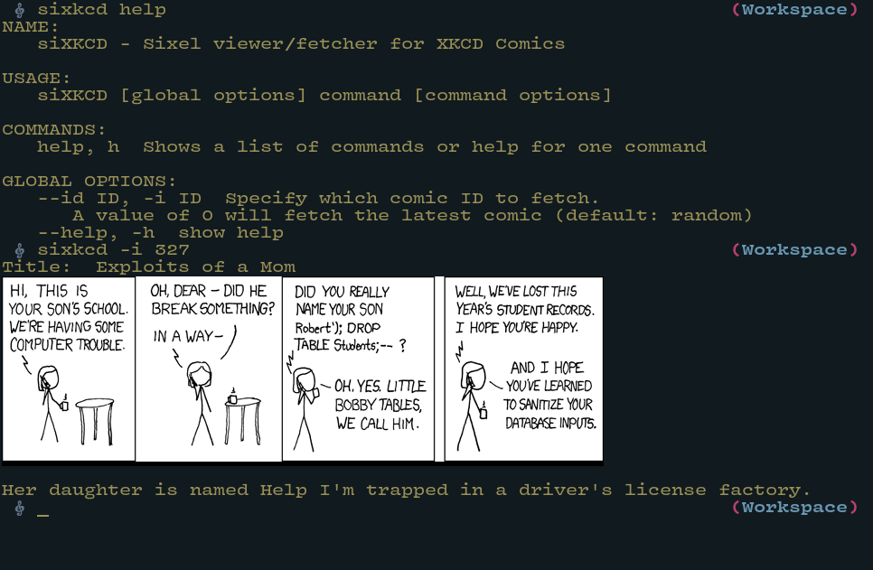

<div align="center">

<br/>

# SiXKCD

XKCD comics in the sixel format (and kitty too!)

</div>

XKCD is great. What's even better is viewing his comics
directly in your terminal using sixel graphics or kitty
graphics protocol!

To achieve this, you need a terminal that supports one of these protocols:
- For sixel support, check: [https://www.arewesixelyet.com/][1]
- For kitty graphics protocol, use [kitty][2], [ghostty][3], [wezterm][4], or any other compatible terminal

The program automatically detects your terminal capabilities and uses the
appropriate rendering method. You can also manually set the renderer using
the `SIXKCD_RENDERER` environment variable (set to "sixel" or "kitty").

<center>



</center>

## Installation

```sh
make
make install
# To uninstall:
make uninstall
```

[1]: https://www.arewesixelyet.com/
[2]: https://sw.kovidgoyal.net/kitty/
[3]: https://ghostty.org/
[4]: https://wezterm.org/
