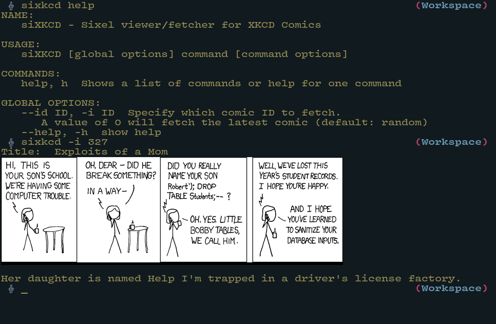

#+author: Benjamin Chausse <benjamin@chausse.xyz>

#+HTML: 

#+HTML:  

* SiXKCD

XKCD comics in the sixel format (and kitty too!)

#+HTML: 

XKCD is great. What's even better is viewing his comics
directly in your terminal using sixel graphics or kitty
graphics protocol!

To achieve this, you need a terminal that supports one of these protocols:
- For sixel support, check: [[https://www.arewesixelyet.com/]]
- For kitty graphics protocol, use kitty terminal or other compatible terminals

The program automatically detects your terminal capabilities and uses the
appropriate rendering method. You can also manually set the renderer using
the =SIXKCD_RENDERER= environment variable (set to "sixel" or "kitty").

#+HTML:

#+HTML:

** Installation

#+begin_src sh
make
make install
# To uninstall:
make uninstall
#+end_src
